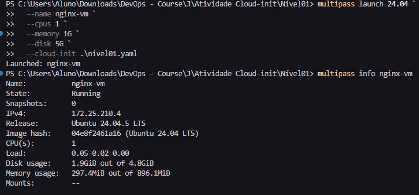
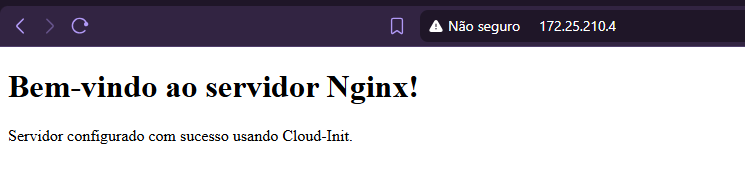

'Comandos para criar a máquina virtual com as configurações utilizando o Multipass:

multipass launch 24.04 `
>>   --name nginx-vm `
>>   --cpus 1 `
>>   --memory 1G `
>>   --disk 5G `
>>   --cloud-init .\nivel01.yaml
Launched: nginx-vm

'

'Comando para chegar as informações da máquina virtual utilizando o multipass:
    multipass info nginx-vm
'

